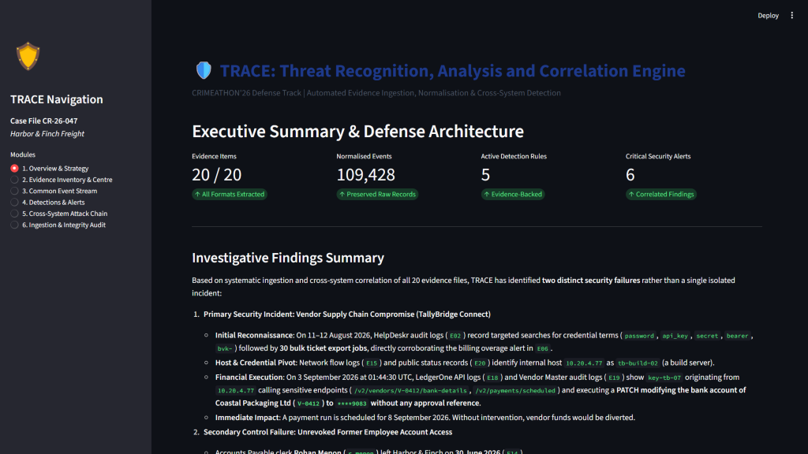

# TRACE: Threat Recognition, Analysis and Correlation Engine
**CRIMEATHON'26 — Defense Track**  
**Investigation Case File:** CR-26-047 (Harbor & Finch Freight Pvt. Ltd.)



---

## 1. Project Overview

TRACE is an evidence-driven cybersecurity defense engine and interactive investigation platform built for CRIMEATHON'26. It ingests enterprise telemetry and operational documentation across disparate enterprise systems, normalises heterogeneous event logs into a common schema without discarding original records, executes evidence-supported detection rules, correlates multi-stage attack progressions, and produces actionable security alerts with objective risk scoring.

---

## 2. Evidence Architecture & Source-to-Schema Mapping

The investigation centers around 20 pristine evidence files extracted into `data/original/`:

| Evidence ID | Source File | Format | Source System | Period | Timezone Basis | Key Columns / Fields | Intended Investigative Use |
| :--- | :--- | :--- | :--- | :--- | :--- | :--- | :--- |
| **E01** | `E01_ledgerone_api_access.csv` | CSV | LedgerOne Finance API | 3 Jun – 31 Aug 2026 | UTC (`YYYY-MM-DDTHH:MM:SSZ`) | `ts_utc`, `request_id`, `api_key_id`, `caller_ip`, `endpoint`, `method`, `status` | Baseline API access patterns, key usage |
| **E02** | `E02_helpdeskr_audit_log.csv` | CSV | HelpDeskr Support Platform | 3 Jun – 31 Aug 2026 | IST (`DD/MM/YYYY HH:MM:SS`) | `ts_local`, `event_id`, `actor`, `action`, `object_id`, `source_ip`, `details` | Credential searches, bulk ticket exports |
| **E03** | `E03_sso_signin_log.csv` | CSV | Single Sign-On (SSO) | 1 Jun – 31 Aug 2026 | UTC (`YYYY-MM-DDTHH:MM:SS+00:00`) | `ts_utc`, `event_id`, `user`, `source_ip`, `city`, `auth_method`, `mfa_result`, `result` | Staff logins, terminated account access |
| **E04** | `E04_connected_software_register.json` | JSON | IT Integration Register | Current state | Calendar dates | `integration`, `credential_id`, `system`, `vendor`, `scope`, `ip_restriction` | Approved integrations, credential scopes |
| **E05** | `E05_bluevault_access_log.csv` | CSV | BlueVault Shared Storage | 3 Jun – 31 Aug 2026 | Unix Epoch (Seconds) | `epoch_s`, `event_id`, `principal`, `source_ip`, `action`, `path`, `bytes` | Statement and invoice access, storage keys |
| **E06** | `E06_billing_alert_and_invoice.pdf` | PDF | Finance / HelpDeskr Billing | Aug 2026 | IST | Text, billing items, invoice numbers | Corroborates bulk export overage (14 exports) |
| **E07** | `E07_onboarding_review_file.pdf` | PDF | Finance IT Due Diligence | Jun 2024 | Calendar dates | Vendor review questions, carve-outs | Vendor assessment gaps, unreviewed scopes |
| **E08** | `E08_contract_excerpt.pdf` | PDF | Legal MSA Excerpt | Jun 2024 | Contract clauses | Sections 5.1, 5.3, 7.2 | Security terms, incident disclosure rules |
| **E09** | `E09_risk_register_extract.xlsx` | Excel | Finance & IT Risk Register | Current | Calendar dates | `Risk ID`, `Risk title`, `Score`, `Treatment` | Known risks (R-018 unrevoked accounts) |
| **E10** | `E10_it_security_policy_v2_1.pdf` | PDF | IT Security Policy v2.1 | Effective Jan 2025 | Policy text | Sections 3.2, 4.1, 6.3 | Dual-control vendor change compliance |
| **E11** | `E11_internal_audit_report_IA_2025_09.pdf` | PDF | Internal Audit Report | Sep 2025 | Audit findings | Finding 1, Finding 3 | Audit history on unrevoked employee access |
| **E12** | `E12_email_notice.pdf` | PDF | External Communication | 21 Aug 2026 | IST | Email headers, advisory body | TallyBridge precautionary disclosure |
| **E13** | `E13_support_team_chat_export.json` | JSON | Support Team Chat | Jun – Aug 2026 | Local IST (`YYYY-MM-DD HH:MM`) | `ts_local`, `channel`, `author`, `text` | Operational context (key `bvk-7f3a` in ticket) |
| **E14** | `E14_staff_roster.csv` | CSV | HR Staff Roster | Current | Dates (`YYYY-MM-DD`) | `employee_id`, `username`, `full_name`, `status`, `termination_date` | Employment verification (Rohan Menon exit) |
| **E15** | `E15_network_link_flow_log.csv` | CSV | Private-Link Network Gateway | 3 Jun – 31 Aug 2026 | UTC (`YYYY-MM-DDTHH:MM:SSZ`) | `ts_utc`, `flow_id`, `src_ip`, `src_label`, `dst_system`, `bytes_out`, `bytes_in` | Identifies `10.20.4.77` as `tb-build-02` |
| **E16** | `E16_followup_email_notice.pdf` | PDF | External Communication | 28 Aug 2026 | IST | Email headers, advisory body | TallyBridge confirmed credential exposure |
| **E17** | `E17_indicator_list.csv` | CSV | External Threat Intelligence | Aug 2026 | Dates | `indicator`, `type`, `confidence`, `vendor_note` | Unverified external threat indicators |
| **E18** | `E18_ledgerone_api_access_1_to_7_sep.csv` | CSV | LedgerOne Finance API | 1 – 7 Sep 2026 | UTC (`YYYY-MM-DDTHH:MM:SSZ`) | Same columns as E01 | API calls on vendor bank details from `10.20.4.77` |
| **E19** | `E19_vendor_master_change_log.csv` | CSV | Vendor Master Audit Log | 3 Jun – 7 Sep 2026 | UTC (`YYYY-MM-DDTHH:MM:SSZ`) | `ts_utc`, `change_id`, `vendor_id`, `field`, `old_value`, `new_value`, `channel`, `approval_ref` | Unauthorized bank detail changes |
| **E20** | `E20_public_records_pack.pdf` | PDF | Public OSINT Records | Saved 2 Sep 2026 | Various | Release notes, status history, domain records | Corroborates `tb-build-02` re-provisioning |

---

## 3. Supported Detection Scenarios

1. **Former Employee Account Access (`RULE-AUTH-001`)**:
   - Cross-references SSO sign-in logs (`E03`) with HR staff roster (`E14`).
   - Flags accounts with populated `termination_date` logging in after departure date.
   - **Case Finding**: Rohan Menon (`r.menon`), terminated on 30 June 2026, logged in on 13 August 2026 at 09:02:00 UTC (`sso-bb8ab61e08`).
2. **Suspicious API Credential Usage & Sensitive Endpoints (`RULE-API-001`)**:
   - Identifies integration keys accessing high-risk endpoints outside normal behavior.
   - Flags calls originating from unauthorized internal hosts (`10.20.4.77` tb-build-02 host rather than sync pool `10.20.4.11-16`).
   - **Case Finding**: `key-tb-07` queries `/v2/vendors/V-0412/bank-details` and `/v2/payments/scheduled` on 3 Sep 2026.
3. **Unusual Bulk Ticket Exports & Credential Reconnaissance (`RULE-EXP-001`, `002`)**:
   - Flags targeted keyword searches in support tickets (`password`, `bvk-`, `api_key`, `secret`, `bearer`).
   - Detects abnormal clustering of bulk export jobs outside the standard Tuesday routine.
   - **Case Finding**: 30 bulk exports in 90 minutes on 11–12 Aug 2026, triggering E06 billing overage.
4. **Vendor Bank-Detail Modifications (`RULE-FIN-001`, `002`)**:
   - Detects changes where `field == 'bank_account'` executed via API channel or lacking an approval reference.
   - **Case Finding**: Bank details for Coastal Packaging Ltd (`V-0412`) modified on 3 Sep 2026 via API `key-tb-07` from `10.20.4.77` (`req-5f61b0de8`) without approval reference.
5. **Cross-System Attack Chain Correlation (`RULE-CORR-001`)**:
   - Links the full chain: Reconnaissance (E02/E13) -> Credential Exposure -> Pivot via Build Server (E15/E18) -> Payment Modification (E19).

---

## 4. Project Directory Structure

```
crimeathon/
├── app.py                         # Streamlit interactive application
├── requirements.txt               # Dependencies
├── README.md                      # Documentation & Run guide
├── data/
│   └── original/                  # Pristine source evidence files (E01-E20)
├── trace_engine/
│   ├── __init__.py
│   ├── ingestion.py               # Robust evidence loaders (CSV, JSON, Excel, PDF)
│   ├── normalisation.py           # Unified event schema and timezone engine (109k events)
│   ├── alert_schema.py            # Standardized ThreatAlert dataclass & schema
│   ├── risk_scoring.py            # Transparent composite risk calculation model
│   ├── rules.py                   # Modular BaseRule detection rules (Auth, API, Doc, Exp, Fin)
│   ├── detection.py               # ThreatDetectionEngine orchestrator & multi-stage synthesis
│   ├── correlation_models.py      # CorrelatedEvent, RelationshipType & InvestigationCase
│   ├── correlation_scoring.py     # CaseRiskScorer multi-factor attribution & penalty engine
│   ├── graph_builder.py           # NetworkX entity-relationship knowledge graph
│   ├── correlation.py             # CrossSystemCorrelationEngine (Cases 01–04)
│   ├── synthetic_data.py          # Synthetic telemetry generator (safe, labeled SIMULATED)
│   ├── scenario_templates.py      # Scenarios A–E generators & held-out variation tests
│   ├── simulation.py              # SimulationLabRunner & confusion matrix metrics
│   └── evaluation.py              # Defensive Performance Evaluation Engine (Modes A–D, Metrics, Reports)
├── reports/
│   ├── defensive_performance_report.md   # Downloadable comprehensive evaluation report
│   └── defensive_performance_report.json # Exported evaluation results data
└── tests/
    ├── __init__.py
    ├── test_foundation.py         # Ingestion, schema, and baseline detection tests
    ├── test_detection_engine.py   # Detection rules, negatives, duplicates, invalid timestamps
    ├── test_correlation_engine.py # Typed relationships, timelines, clock drift, NetworkX graph
    ├── test_simulation_lab.py     # Scenarios A–E, confusion matrix, held-out variation battery
    └── test_evaluation_engine.py  # Diagnostic metrics, zero-safe math, evaluation modes, robustness

---

## 5. Investigation Cases & Relationship Correlation

TRACE correlates evidence across E01–E20 into 4 dedicated investigation cases with 4 typed relationships:
1. **Direct Identifier Matching** (e.g. `r.menon`, `key-tb-07`, `10.20.4.77`, `V-0412`, `req-5f61b0de8`)
2. **Temporal Correlation** (events within calibrated time windows, recording clock-drift uncertainty)
3. **Contextual Association** (integration scopes from E04, staff roster from E14, contract from E08)
4. **Unverified Association** (vendor self-reported indicators from E17, external notices E12/E16)

### Investigation Cases
- **CASE-01: Terminated Employee Account Activity (Rohan Menon / `r.menon`)**
  - Confirmed departure on 30 June 2026 (E14).
  - Unrevoked SSO sign-in on 13 August 2026 at 09:02 UTC from warehouse kiosk (E03 `sso-bb8ab61e08`).
  - Corroborates historical audit finding IA-2025-09 Finding 3 (E11) and Risk Register R-018 (E09).
- **CASE-02: Integration Credential Abuse & Sensitive Reconnaissance (`key-tb-07`)**
  - Legitimate integration scope in E04 is `/v2/sync/orders` and `/v2/sync/inventory` from `10.20.4.11-16`.
  - Abused on 3 Sep 2026 from unauthorized build server `10.20.4.77` to probe `/v2/vendors/V-0412/bank-details` and `/v2/payments/scheduled` (E18).
- **CASE-03: Unauthorized Vendor Master Modification (Coastal Packaging / `V-0412`)**
  - Unapproved PATCH request on 3 Sep 2026 at 01:44:30 UTC changing bank account to `****9083` (E18/E19 `req-5f61b0de8`).
  - Breaches dual-authorization control mandated in IT Security Policy Section 4.1 (E10).
- **CASE-04: Support Ticket Reconnaissance & Bulk Exfiltration (HelpDeskr -> BlueVault)**
  - Targeted searches for credentials (`bvk-`, `api_key`) and 30 bulk export jobs on 11–12 Aug 2026 (E02).
  - Corroborated by HelpDeskr billing overage invoice (E06) and support ticket chat revealing key `bvk-7f3a` (E13).
  - Cross-system download of customer statements and bank instructions in BlueVault (E05).

---

## 6. Controlled Cybersecurity Simulation Lab

TRACE features a completely local, self-contained simulation laboratory to benchmark detection rules against variations and adversary behavior:
- **Zero Real-World Risk**: Telemetry is generated locally in-memory; never attacks or connects to external systems.
- **Strict Integrity Separation**: Every synthetic record is explicitly tagged with `is_synthetic: True`, `SIMULATED_TEST_LAB`, and fictional synthetic IDs (`SIM-...`).
- **5 Evaluation Scenarios**:
  - **Scenario A**: Former employee access (success/failure, trusted/untrusted IPs, timing variations).
  - **Scenario B**: Compromised integration key (`key-tb-07` off-scope sensitive endpoint access, build server IP).
  - **Scenario C**: Suspicious vendor bank modification (unapproved API changes vs. approved portal changes).
  - **Scenario D**: Unusual bulk ticket exports (abnormal export bursts vs. routine single-ticket exports).
  - **Scenario E**: Full multi-stage attack sequence combining Scenarios A through D across time windows.
- **Generalization Battery**: 6 held-out variations testing unseen IPs, missing optional fields, altered event orders, and legitimate lookalikes.
- **Evaluation Metrics**: Automated calculation of True Positives ($TP$), False Positives ($FP$), True Negatives ($TN$), False Negatives ($FN$), Precision, Recall, and F1 Score.

---

## 7. Defensive Performance Evaluation Engine

A reproducible diagnostic evaluation framework assessing detection efficacy, false-alarm mitigation, and robustness across 34 ground-truth benchmark cases:

### Evaluation Modes
1. **Mode A: Rule Validation (14 test cases)**: Tests individual detection rules against isolated positive and negative controls.
2. **Mode B: Scenario Validation (6 test cases)**: Tests complete multi-event scenarios through the detection and correlation pipeline.
3. **Mode C: Unseen Variation Testing (6 test cases)**: Assesses generalization against novel IPs, mixed casing, non-standard approval tokens, and off-hours logins.
4. **Mode D: Robustness Stress-Testing (8 test cases)**: Stress-tests performance under 8 perturbation dimensions:
   - Missing optional fields
   - Microsecond timestamp variation
   - Arbitrary external IP subnets
   - Out-of-order sequence inversion
   - High-frequency duplicate telemetry bursts
   - Legitimate portal bank modifications with dual-authorization
   - High-volume routine API order syncs
   - Unrelated background diagnostic noise

### Performance Metrics & Confusion Matrix
- **Ground Truth**: Explicitly labeled for benchmark cases ($1$ = Suspicious, $0$ = Legitimate).
- **Separation of Evidence**: Raw competition evidence ($E01$–$E20$) has unknown ground truth and is strictly excluded from supervised accuracy calculations.
- **Zero-Safe Math**: Safe division handling zero denominators with informative diagnostic notes.

```bash
# Standalone CLI evaluation
python -m trace_engine.evaluation
```

---

## 8. Installation & Exact Run Commands

### Step 1: Install Dependencies
```bash
pip install -r requirements.txt
```

### Step 2: Run Full Automated Test Suite
```bash
python -m unittest discover tests
```
*Expected output: `Ran 38 tests in ~44s ... OK` across foundation, detection engine, correlation engine, simulation lab, and defensive evaluation engine.*

### Step 3: Launch Streamlit Application
```bash
streamlit run app.py
```

The application will open in your browser at `http://localhost:8501`.

---

## 9. TRACE — Behavioral Defense Front-End

TRACE is the specialized, single-page behavioral defense interface built for Harbor & Finch Freight. It visualizes credential behavior inside defined shipping corridors, contrasts observed activity against behavioral contracts, explains why ordinary-looking events were set aside, and places a security gate in front of the monthly vendor payment run.

### Running TRACE (Single-Command Execution)

TRACE has zero build steps and zero runtime npm dependencies. Launch it locally with Python's built-in web server:

```bash
# Launch from project root
python -m http.server 8000
```

Open your browser to: **`http://localhost:8000/`** (or open `index.html` directly).

### Plugging In Live Detector Output

TRACE consumes three structured, human-readable JSON files:

1. **`events.json`**: Replay telemetry containing the 8 verified breach records, 5 forensic set-aside events, and sampled baseline corridors.
2. **`contracts.json`**: Behavioral contracts specifying allowed network CIDRs, client SDK versions, time-of-day sync windows, endpoint scopes, and dual-control approval rules.
3. **`metrics.json`**: Ground-truth benchmark evaluation statistics comparing TRACE against traditional IOC blocklists.

To update TRACE with live detector findings, simply export your detector results into `events.json` and `metrics.json`:
```bash
# Export latest evaluation run to metrics.json
python -c "from trace_engine.evaluation import DefensiveEvaluationEngine; import json; res = DefensiveEvaluationEngine().run_all(); open('metrics.json', 'w').write(DefensiveEvaluationEngine().generate_report(res, format='json'))"
```
